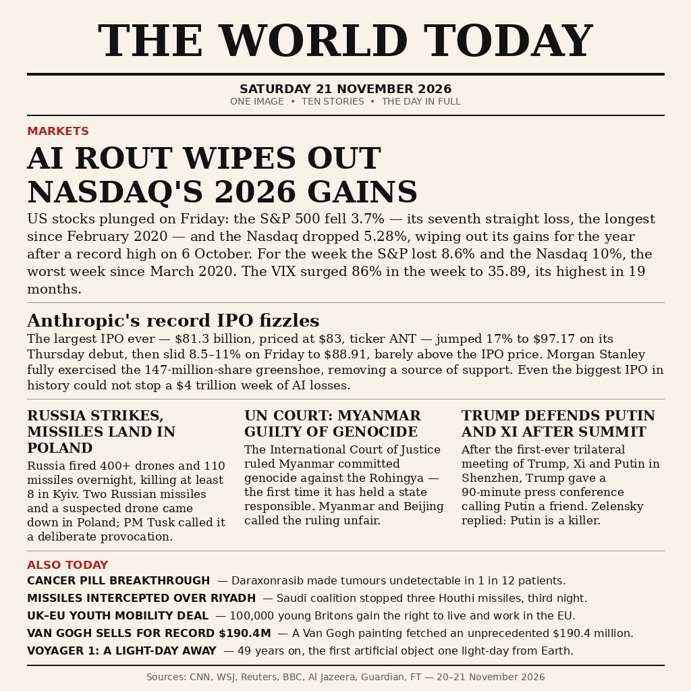

# The World Today — Saturday 21 November 2026

[](https://make.fun/bounty/news-image-20261121?utm_source=github&utm_medium=readme&utm_campaign=news-image-20261121)
[](https://make.fun/bounty/news-image-20261121/leaderboard?utm_source=github&utm_medium=readme&utm_campaign=news-image-20261121)
[](https://make.fun/bounty/news-image-20261121?utm_source=github&utm_medium=readme&utm_campaign=news-image-20261121)

One image that sums up Saturday 21 November 2026's world news, drawn as a
newspaper front page: masthead, lead story, sub-head, three mid stories and a
five-item strip — ten verified stories in total.



## The ten stories

1. **AI rout wipes out Nasdaq's 2026 gains** — US stocks plunged on Friday:
   S&P 500 −3.7% (seventh straight loss, longest since February 2020),
   Nasdaq −5.28%, now down for the year after a record high on 6 October.
   For the week the S&P lost 8.6% and the Nasdaq 10% — the worst week since
   March 2020. The VIX surged 86% in the week to 35.89, highest in 19 months.
2. **Anthropic's record IPO fizzles** — the largest IPO ever ($81.3 billion,
   priced $83, ticker ANT) jumped 17% to $97.17 on debut Thursday, then slid
   8.5–11% on Friday to $88.91, barely above the IPO price. Morgan Stanley
   fully exercised the 147-million-share greenshoe.
3. **Russia's biggest strikes on Ukraine; missiles land in Poland** — 400+
   drones and 110 missiles overnight, at least 8 killed in Kyiv; two Russian
   missiles and a suspected drone came down in Poland.
4. **UN court: Myanmar guilty of Rohingya genocide** — the International
   Court of Justice held a state responsible for genocide for the first time.
5. **Trump defends Putin and Xi ties after the Shenzhen summit** — after the
   first-ever trilateral meeting of Trump, Xi and Putin, Trump called Putin a
   friend in a 90-minute press conference; Zelensky replied Putin is a killer.
6. **Pancreatic cancer pill breakthrough** — trial pill daraxonrasib made
   tumours undetectable on scans in 1 in 12 patients.
7. **Houthi missiles intercepted over Riyadh, third night** — the Saudi-led
   coalition intercepted three Houthi missiles aimed at the capital.
8. **UK–EU youth mobility deal** — food and drink trade, emissions trading,
   and a youth mobility scheme for 100,000 young Britons, the biggest step
   towards the EU since Brexit.
9. **Van Gogh sells for record $190.4 million** at auction.
10. **Voyager 1, first object a light-day away** — 49 years after launch,
    NASA's probe is the first artificial object one light-day from Earth.

Sources: CNN, WSJ, Reuters, BBC, Al Jazeera, Guardian, FT — 20–21 November 2026.

## How to run

```sh
# 1. Draw the front page (deterministic: two runs are byte-identical)
python3 dev/make_image.py

# 2. Validate the PNG and copy it to the output directory
#    (MAKEFUN_OUTPUT_DIR defaults to /output)
MAKEFUN_OUTPUT_DIR=/output node main.ts
```

`main.ts` uses only the Node standard library. It checks the PNG magic bytes,
that the first chunk is IHDR, that the image is at most 1024×1024, and that
the file ends with an IEND chunk, then copies `entry.png` to the output
directory and verifies the copy byte-for-byte.

## License

MIT — see [LICENSE](LICENSE).
